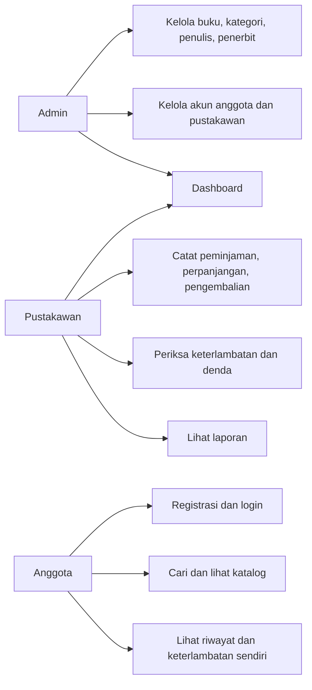
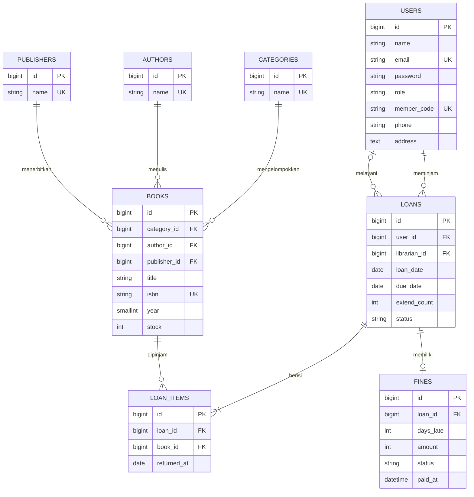
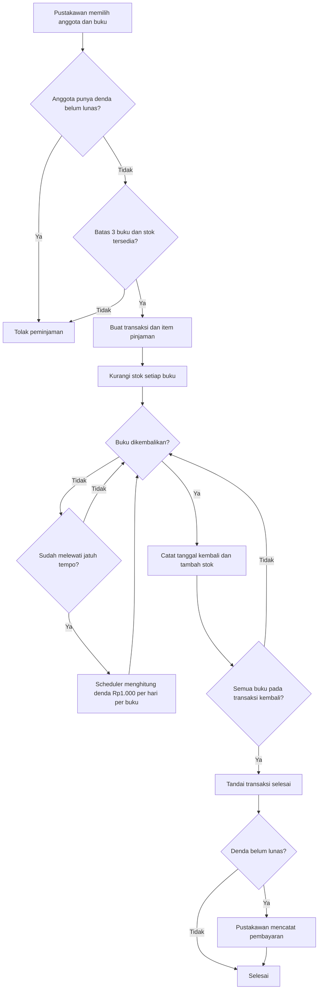

# Desain Sistem Perpustakaan

Dokumen ini merangkum desain web MVC Fase 1 dari PRD. Peran `pustakawan` juga merupakan petugas layanan.

## Use case

## ERD

## Alur peminjaman dan pengembalian

## Aturan implementasi

- Satu transaksi boleh berisi maksimal tiga buku; anggota juga dibatasi maksimal tiga buku aktif secara total.
- Denda dihitung Rp1.000 per hari per buku terlambat dan diringkas per transaksi.
- Peminjaman baru ditolak selama ada denda belum lunas.
- Penghapusan buku/master/akun yang sudah direferensikan transaksi ditolak agar riwayat tetap utuh.
- Scheduler `loans:sync-fines` dijalankan setiap hari pukul 00:10 untuk memperbarui denda pinjaman aktif yang terlambat.
